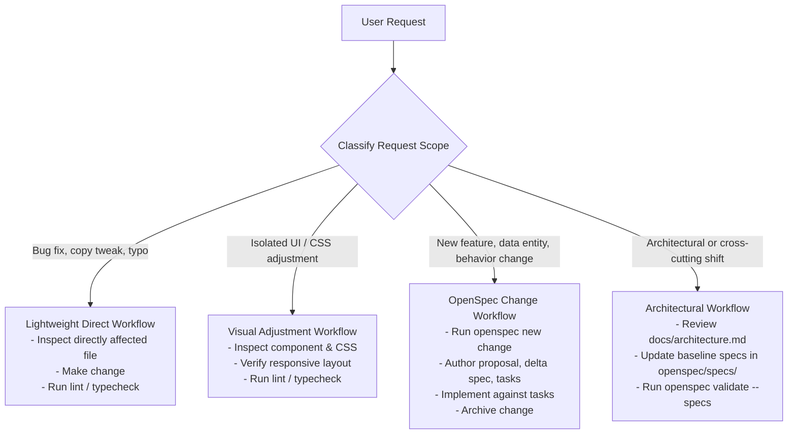

# Development Workflow & OpenSpec Integration

This guide defines the standard engineering workflow for implementing new features, bug fixes, and architectural enhancements using **OpenSpec** (`@fission-ai/openspec`).

---

## 1. Task Classification & Workflow Decision Tree

To avoid token waste and unnecessary specification overhead, classify every incoming task before writing code:



- **Lightweight (No OpenSpec change required)**:
  - Typo corrections, text adjustments in `src/data/translations.ts`.
  - Adding an entry to an already specified data module (e.g., adding a project or post).
  - Minor CSS polish or responsive alignment tweaks.
- **Specification-Driven (OpenSpec change required)**:
  - Adding a new page route or major interactive section.
  - Introducing a new data domain or changing existing data contracts.
  - Modifying the build pipeline, export targets, or localization system.

---

## 2. The OpenSpec Feature Lifecycle

When working on a feature requiring specification:

### Step 1: Propose the Change

Create a new isolated change folder using the OpenSpec CLI or AI slash command:

```bash
# Using CLI
npx openspec new change add-newsletter-subscription

# Or in AI Assistant chat
/opsx-propose "add newsletter subscription"
```

This generates:

- `openspec/changes/<change-name>/proposal.md` — What problem is being solved, motivation, and scope boundaries.
- `openspec/changes/<change-name>/specs/<capability>/spec.md` — Delta specification with `ADDED` or `MODIFIED` requirements and scenarios (using RFC 2119 keywords `SHALL` or `MUST`).
- `openspec/changes/<change-name>/design.md` — Technical design, affected components, and state management.
- `openspec/changes/<change-name>/tasks.md` — Actionable implementation checklist.

### Step 2: Validate Artifacts

Ensure the specification adheres to OpenSpec rules:

```bash
npx openspec validate <change-name>
```

### Step 3: Implement

- Follow the sequence defined in `tasks.md`.
- Inspect only the files identified in `tasks.md` and `docs/project-map.md`.
- Do not make speculative refactorings outside the change scope.
- Mark completed tasks in `tasks.md` as work progresses.

### Step 4: Verify & Check Status

Check task completion status:

```bash
npx openspec status --change <change-name>
```

Run project quality checks:

```bash
npm run format:check
npm run lint
npm run typecheck
npm run build
```

### Step 5: Archive the Change

Once implementation and validation are complete, archive the change:

```bash
npx openspec archive <change-name>
```

OpenSpec merges the delta requirements into the main baseline specifications under `openspec/specs/` and moves the change folder to `openspec/changes/archive/`.

---

## 3. Essential OpenSpec Commands Reference

| Command                               | Purpose                                                   |
| :------------------------------------ | :-------------------------------------------------------- |
| `npx openspec list`                   | List all active changes in progress                       |
| `npx openspec list --specs`           | List all project baseline specifications                  |
| `npx openspec new change <name>`      | Create a new isolated change directory                    |
| `npx openspec status --change <name>` | View artifact and task completion progress                |
| `npx openspec validate <name>`        | Validate formatting and requirements for an active change |
| `npx openspec validate --specs`       | Validate all baseline specifications in `openspec/specs/` |
| `npx openspec archive <name>`         | Finalize change and merge delta specs into baseline       |
| `npx openspec doctor`                 | Check health and repository root resolution               |

For complete documentation, refer to the [official OpenSpec repository](https://github.com/Fission-AI/OpenSpec).
